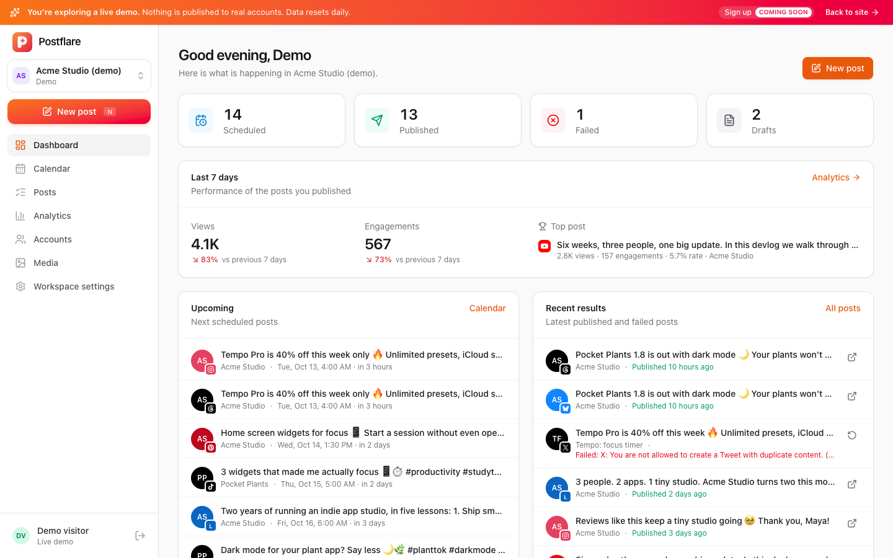
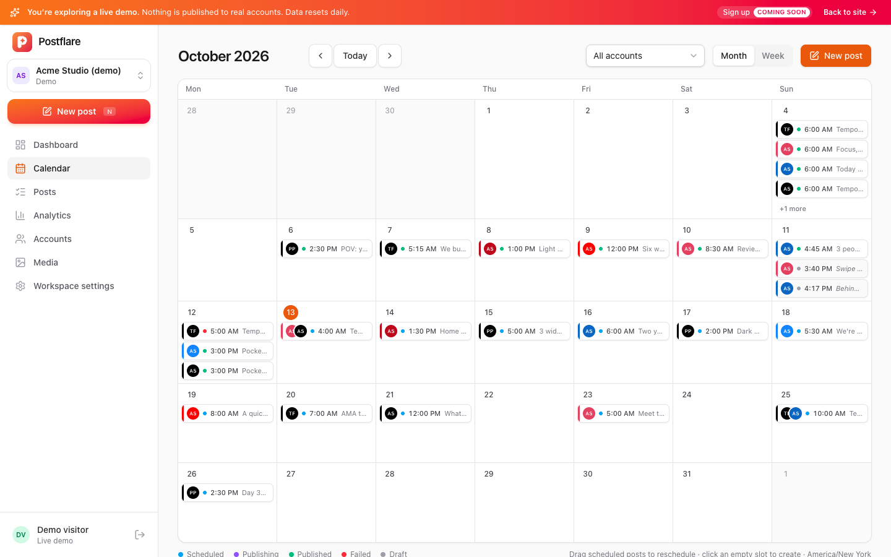
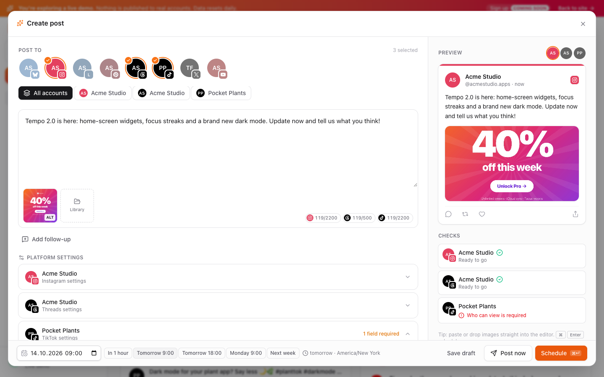
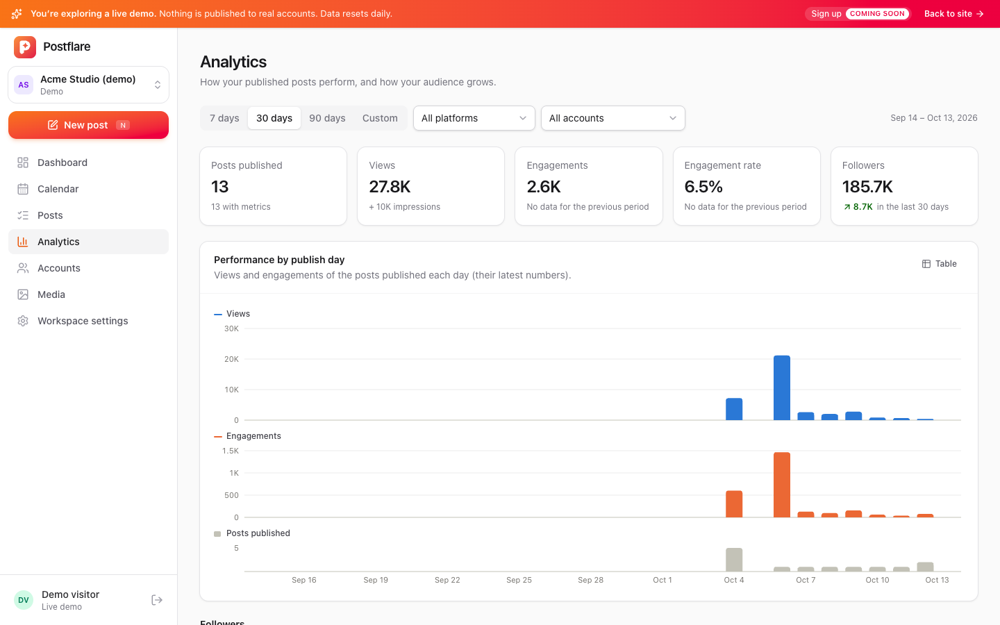

# Postflare

[](LICENSE)
[](https://www.npmjs.com/package/postflare)
[](https://github.com/FerdiKT/postflare/actions/workflows/ci.yml)

A **Postiz-inspired, Cloudflare-native** social media scheduler. It runs **entirely on Cloudflare** (one Worker, D1,
R2, Workflows and Images): no servers, no Docker, no Postgres/Redis, and it fits the **Workers Free plan**.

Love [Postiz](https://github.com/gitroomhq/postiz-app) but don't want to run and maintain a server for it? Postflare
takes the same idea and rebuilds it for Cloudflare's serverless platform, so you can deploy your own instance in one
click. It is an independent project, not affiliated with or endorsed by Postiz.

[](https://deploy.workers.cloudflare.com/?url=https://github.com/FerdiKT/postflare)

**Live demo: [postflare.ferdi.app/demo](https://postflare.ferdi.app/demo)** (official demo instance; a sandboxed
workspace with sample data that never publishes anything, reset daily).

## Screenshots

| Dashboard | Calendar |
|---|---|
|  |  |
| **Composer** | **Analytics** |
|  |  |

## Features

- **36 integrations, 3 verified and the rest in beta** (see [Platform status](#platform-status)): X, LinkedIn (profile +
  pages), Facebook Pages, Instagram (Facebook login and Instagram login), Threads, YouTube, TikTok, TikTok for Business,
  Pinterest, Reddit, Bluesky, Mastodon, Tumblr, VK, Nostr, Farcaster, Lemmy, Dribbble, Google Business Profile,
  Telegram, Discord, Slack, Twitch, Kick, DEV, Hashnode, Medium, WordPress, Listmonk, MeWe, Whop, Moltbook, a generic
  Webhook and (experimental, off by default) Skool.
- Composer with per-account customisation, live limits per platform, platform-specific settings (titles, privacy, boards,
  subreddits, channels, playlists...), threads / first comments, previews, drafts.
- Calendar (month/week, drag to reschedule), posts list with publishing logs, retry/cancel.
- **Account groups**: group accounts by brand or project (e.g. one app's Instagram, TikTok and YouTube). The Accounts
  page shows them by platform, by group or as one list, with search and bulk "Move to group"; the composer selects a
  whole group at once, Posts and Calendar filter by group, and agents post to a group (`pf post -a group:<name>`, MCP
  `list_accounts` with `group`).
- Media library on R2: multipart uploads up to 5GB, alt text, import from URL. Big videos are streamed to platforms in
  chunks, never loaded into memory. Storage usage is shown against the R2 Free plan's 10 GB, and a daily job applies
  the **media retention** (Instance settings, default 30 days, 0 = keep forever): media older than that is deleted
  once no draft, scheduled, failed or needs-check post uses it. Media of posts published to platforms that keep linking
  to our copy (DEV, Hashnode, Medium, Listmonk, Nostr, Farcaster, Discord embeds, webhooks) is kept. Unfinished uploads
  are removed after 2 days, and upload-link files never used in a post after 7 days. Media used by a draft or scheduled
  post cannot be deleted.
- Reliable publishing with **Cloudflare Workflows**: each post sleeps until its time, publishes, polls platform
  processing (videos, Instagram containers, TikTok) and then posts follow-ups. A cron re-arms anything lost and
  refreshes tokens before they expire. **No double posts**: only failures that certainly created nothing (rate limits,
  failed uploads) are retried. When the request that creates the post fails in a way that does not tell whether the
  platform accepted it (network error, timeout, server error), the post goes to **Needs check** instead: check the
  profile, then **Mark as published** (optionally with its URL) or **Retry anyway** in the post drawer
  (`POST /api/posts/:id/resolve`, `pf posts resolve`).
- **Analytics**: views, reach, likes, comments, shares... of published posts and daily follower counts, collected by the
  cron within the Free plan budget (see [Analytics](#analytics)).
- **Playbooks**: 20 built-in, versioned recipes for posts that perform (launches, threads, short-video hooks, app
  feature spotlights, game clips...), plus your workspace's own. AI agents find them over MCP and the CLI, posts record
  the playbook they were written with, and a ranking shows which ones beat each account's usual (see
  [Playbooks](#playbooks)).
- **App Store campaign links**: posts about one of your iOS apps get a tracked short link (`/a/<code>`) with an App
  Store campaign token per post and platform; clicks are counted, and with an optional Revflare connection Apple's
  installs and proceeds show per post, platform, account and playbook (see
  [App Store campaigns](#app-store-campaigns)).
- **Users, workspaces and roles**: several people on one deployment, each workspace with its own accounts, posts and
  media; built-in and custom permission-based roles, invite links (see [below](#users-workspaces-and-roles)).
- REST API with per-workspace API keys and a built-in **MCP server** (`/mcp`) so AI agents can schedule posts and read
  analytics.
- **[`postflare` CLI](cli/README.md)** (`npm i -g postflare`, alias `pf`) and a **Claude Code skill** for terminal and
  agent workflows.
- Optional public **live demo mode**: a sandboxed, self-resetting demo workspace (see [Live demo](#live-demo-optional)).
- **Runs on the Workers Free plan**: media is streamed, never buffered, and every provider call stays within the
  Free plan's CPU and subrequest limits.
- Secrets (platform tokens, app credentials) are encrypted at rest with AES-GCM.

## Platform status

Every integration is implemented against the platform's API and covered by tests with mocked API responses, but only
some have been confirmed end to end with a real account so far. Each platform shows its status as a badge in the app
(Platforms page and connect dialog).

| Status | Meaning |
|---|---|
| **Verified** | Publishing confirmed against the live API with a real account. |
| **Beta** | Built against the official API and tested with mocked responses; not yet confirmed with a live account. Please report issues. |
| **Experimental** | Uses an unofficial API: may break without notice and may conflict with the platform's terms. Hidden until an instance admin turns on **Admin → Instance settings → Enable experimental integrations** (already connected accounts keep publishing when it is off). |

| Platform | Status | Notes |
|---|---|---|
| TikTok | Verified | Publishing verified with a sandbox app; unaudited apps post privately ("Only me") |
| Webhook | Verified | Generic outgoing webhook (Zapier, Make, n8n, your backend) |
| Instagram (Instagram login) | Beta | Connection verified; publishing being verified |
| Instagram (Facebook login) | Beta | Needs a Facebook Page linked to the Instagram account |
| X (Twitter) | Verified | Publishing verified; posting and reading metrics need X API write access or credits |
| LinkedIn | Beta | |
| LinkedIn Page | Beta | |
| Facebook Page | Beta | |
| Threads | Beta | |
| Bluesky | Beta | App password, no developer app |
| Mastodon | Beta | Access token, any instance |
| Pinterest | Beta | |
| Reddit | Beta | |
| Tumblr | Beta | |
| VK | Beta | |
| Nostr | Beta | Private key, notes signed in your Worker |
| Farcaster | Beta | Neynar managed signers |
| Lemmy | Beta | |
| Dribbble | Beta | |
| MeWe | Beta | Needs MeWe developer access; tokens cannot be refreshed (reconnect about monthly) |
| Whop | Beta | |
| Moltbook | Beta | |
| YouTube | Beta | Uploads from unverified Google projects are private |
| TikTok Business | Beta | TikTok API for Business (business accounts) |
| Google Business Profile | Beta | Needs approved access to the Business Profile APIs |
| Twitch | Beta | Chat messages / announcements in your own channel |
| Kick | Beta | Chat messages in your own channel |
| Telegram | Beta | Bot token |
| Discord | Beta | |
| Slack | Beta | |
| DEV | Beta | API key |
| Hashnode | Beta | Personal access token |
| Medium | Beta | Medium no longer issues integration tokens; existing tokens keep working |
| WordPress | Beta | Application password |
| Listmonk | Beta | |
| Skool | Experimental | Uses Skool's unofficial, cookie-based API; may break and may conflict with Skool's terms |

**Tried a beta platform? [Open an issue](https://github.com/FerdiKT/postflare/issues/new) with the result — that's how
platforms move to Verified.** Statuses live in the code (`status` / `statusNote` in `worker/providers/<id>.ts`,
default `beta`), so a pull request that verifies a platform updates it there and in this table.

## Installing

There are two ways to install Postflare; both deploy to your own Cloudflare account (the Workers Free plan is enough).

### One click (Deploy to Cloudflare button)
Use the button above. Cloudflare creates the Worker, D1 database, R2 bucket, Workflow and Images binding, and a copy
of this repository in your GitHub (or GitLab) account, connected to **Workers Builds**: every push to its production
branch is deployed. The database schema is applied automatically on the first request. To update later, see
[Updating](#updating).

### From your machine
```bash
git clone --branch v0.1.0 https://github.com/FerdiKT/postflare.git   # or the latest release tag
cd postflare
npm ci
npx wrangler login
npm run deploy
```
Open the printed `*.workers.dev` URL and create the first user (instance admin) and workspace.

Optional settings:
- `SECRET_KEY` (secret, recommended): encryption key for stored tokens. Without it a key is generated and stored in D1
  next to the encrypted tokens, so a copy of the database is enough to decrypt them. Set it **before** connecting
  accounts: changing it later makes the stored tokens unreadable (reconnect the accounts then).
  `npx wrangler secret put SECRET_KEY`
- `SETUP_TOKEN` (secret): until the first user is created, anyone who opens the URL can create it and become admin.
  With this secret set, the setup form asks for it. `npx wrangler secret put SETUP_TOKEN`
- `PUBLIC_URL` (var): your public URL if you use a custom domain. It can also be changed in Settings.
- `DEMO_MODE` (var): `"true"` hosts the public live demo. Off by default.
- `UPDATE_CHECK` (var): `"false"` turns off the daily check for new releases (one request a day to the GitHub API).
- `EMAIL_FROM` (var) plus a `send_email` binding named `EMAIL`: **sign-in links by email** through Cloudflare
  [Email Sending](https://developers.cloudflare.com/email-service/). Users can then request a one-time link ("Email me a
  sign-in link instead" on the sign-in page; single use, 15 minutes, 3 per email and 10 per IP per 15 minutes) instead
  of typing their password. Off by default: once configured, an instance admin turns it on in **Admin → Instance
  settings → Sign-in links by email** (with a "Send test email" button). Setup:
  1. Onboard your domain to Email Sending: `npx wrangler email sending enable example.com`.
  2. In `wrangler.local.jsonc`: `"send_email": [{ "name": "EMAIL", "remote": true }]` and the var
     `"EMAIL_FROM": "Postflare <login@example.com>"` (or a bare address), then deploy.

  Sending to any address needs **Workers Paid** ($5/month). On the Free plan the binding only delivers to your
  account's verified Email Routing destination addresses, enough for a personal instance.

### Custom domain / personal config

The committed [`wrangler.jsonc`](wrangler.jsonc) is generic: it deploys to a `*.workers.dev` URL with no vars. Keep
your own settings (custom domain, `PUBLIC_URL`, `DEMO_MODE`...) out of git in **`wrangler.local.jsonc`**:

```bash
cp wrangler.local.example.jsonc wrangler.local.jsonc   # git-ignored; edit the domain and vars
npm run deploy
```

When `wrangler.local.jsonc` exists, `npm run dev`, `npm run build` and `npm run deploy` use it instead of
`wrangler.jsonc` (set `WRANGLER_CONFIG=path/to/config.jsonc` to pick any other file). It is a full config, not a patch,
so keep it in sync when `wrangler.jsonc` changes. Keep the worker `name`, binding names, `database_name`,
`bucket_name` and workflow `name`: existing Cloudflare resources are matched by them.

How it works: the Vite build resolves the config and writes it to `dist/postflare/wrangler.json`, and `wrangler deploy`
deploys that file (through `.wrangler/deploy/config.json`). Check what will be deployed with
`npm run build && npx wrangler deploy --dry-run`. `npm run cf-typegen` always reads the generic `wrangler.jsonc`.

**Runs on the Workers Free plan.** Media is piped from R2 to the platforms without passing through JavaScript
(measured: ~3ms CPU to stream 100MB), every provider call stays under 40 outgoing requests, and long uploads resume
across Workflow steps. Request handlers and cron runs stay well under the Free plan's 50 D1 queries per invocation
(writes are batched; tested in `test/workers/publish.test.ts`). Two crons: every 15 minutes (publishing safety nets,
token refreshes, a couple of account avatar copies, analytics) and daily at 03:00 UTC (cleanups, media retention, update check). Free plan quotas
(requests, D1, R2, Workflows) are plenty for a personal scheduler; R2 storage (10 GB) is the first one media-heavy use
reaches, hence the media retention.

### Custom media domain (optional, recommended)

By default every media view (the app, the iOS app, and platforms that pull files by URL: Instagram, Threads, Facebook,
Pinterest, TikTok photos...) goes through the Worker's signed `/m/` links: one Worker request, one D1 read and one R2
read each. Serve media straight from R2 instead:

1. Cloudflare dashboard → **R2** → bucket `postflare-media` → **Settings** → **Custom Domains** → *Connect domain*, e.g.
   `cdn.social.example.com` (the zone must be on your account). Objects are then public at
   `https://cdn.social.example.com/<key>` (keys are `<media id>/<file name>`; media ids are 96 random bits, so URLs
   cannot be guessed; the bucket root is not listable).
2. Optional but useful: a **Cache Rule** for that hostname (*Caching* → *Cache Rules*: hostname equals
   `cdn.social.example.com` → eligible for cache, edge TTL and browser TTL e.g. 1 day). Repeat views are then served from
   Cloudflare's cache and the browser/app cache without even an R2 read.
3. Set `"MEDIA_PUBLIC_URL": "https://cdn.social.example.com"` (no trailing slash) in `wrangler.local.jsonc` → `vars`
   and deploy.

From then on the API, the app, MCP, the CLI and the providers hand out `https://cdn.../<key>` URLs (`url` and `thumbUrl`
of media). Range requests work (videos stream and seek). Free plan: views no longer count against the Worker's 100,000
requests/day nor D1 reads; R2 reads are free up to 10 million/month and cached views cost none. Old `/m/` links (already
given to platforms or in published posts) keep working, and unfinished uploads only ever get `/m/` links. Keep the
domain once set: CDN URLs given to platforms (and to platforms that keep linking to our copy) depend on it. TikTok pulls
photos by URL from verified domains only: verify the media domain in your TikTok app too.

Account avatars are copied into the same bucket (`avatars/<account id>-<hash>.<ext>`, see `docs/api.md`) because the
platforms' picture links expire: with the media domain they are served from it, otherwise from signed `/m/avatars/`
links.

Deleting media removes the file (and its thumbnail) from R2 right away, but with a Cache Rule the edge and browsers may
keep serving a copy for up to its TTL (1 day above). Purge the URL in the dashboard (*Caching* → *Purge*) if a file must
disappear at once.

**Image thumbnails.** Each image upload (single, multipart, from a URL, upload links) gets one small WebP thumbnail
(max 480 px) made with the Images binding and stored next to the file (`<media id>/thumb/480.webp`); the media grid,
composer and apps load it instead of the full image. One Images transformation per image upload: the Images Free plan
includes 5,000 unique transformations a month (shared with providers that resize images). Without the binding, or when a
transform fails, the upload works as before (`thumbUrl: null`, clients show the file itself). Images uploaded before
this have no thumbnail.

## Updating

Updating Postflare means deploying the new code: **database migrations are applied automatically** on the first
request (they are additive), there is no separate migrate step. Instance admins see new releases in **Admin → Instance
settings** (and a badge in the sidebar); the instance checks GitHub once a day (`UPDATE_CHECK = "false"` turns it off,
`UPDATE_REPO` follows another repository).

Before updating:
- Read the [release notes](https://github.com/FerdiKT/postflare/releases) of every version you skip, for breaking
  changes and manual steps (new secrets or vars, `wrangler.jsonc` changes).
- Note a D1 restore point, in case you need to go back:
  `npx wrangler d1 time-travel info DB` prints a bookmark;
  `npx wrangler d1 time-travel restore DB --bookmark <bookmark>` restores it (add `-c wrangler.local.jsonc` if you use one).

### Installed from your machine
```bash
git fetch --tags
git checkout v0.2.0        # the release you want (or: git switch main && git pull, for the latest code)
npm ci
npm run deploy
```
If you have a `wrangler.local.jsonc`, compare it with the new `wrangler.jsonc` (new bindings, crons...) before
deploying: it is a full config, not a patch.

### Installed with the Deploy to Cloudflare button
Your copy of the repository includes the [**Postflare update**](.github/workflows/postflare-update.yml) workflow.
Every week (or when you run it from your repository's **Actions** tab) it compares your `package.json` version with the
latest Postflare release and, when there is a newer one, opens a pull request that updates your code to it. **Merging
the pull request deploys the update** through Workers Builds.

- One-time setup in your copy: **Settings → Actions → General → Workflow permissions → Allow GitHub Actions to create and
  approve pull requests**. Without it the workflow pushes the branch and opens an issue with a link to create the pull
  request yourself.
- The pull request never touches your `wrangler.jsonc` (Cloudflare wrote your resource names/ids into it),
  `wrangler.local*.jsonc`, `.dev.vars*` or `.github/workflows/`. When the new release changed `wrangler.jsonc`, the pull
  request shows the upstream diff so you can apply new bindings or crons by hand; changed workflow files are listed too
  (the Actions token cannot update them).
- Files you added yourself are kept; files removed upstream are removed.
- GitHub pauses scheduled workflows in repositories without activity for 60 days: run it by hand then, or re-enable it.
- Without the workflow (or on GitLab), update by hand: copy the files of the new release over your copy except the ones
  above, commit and push. The script the workflow runs does exactly that from the root of your copy:
  `bash scripts/postflare-update.sh check` and `bash scripts/postflare-update.sh apply v0.2.0`.

## Versioning & releases

- Postflare follows [semantic versioning](https://semver.org). Server releases are tagged `v<version>` and listed on the
  [releases page](https://github.com/FerdiKT/postflare/releases) with their notes; all changes are in
  [CHANGELOG.md](CHANGELOG.md). Before 1.0, minor versions (0.x.0) may contain breaking changes: they are called out in
  the release notes with upgrade steps.
- The running version is shown in Admin → Instance settings and served at `GET /api/version`
  (`{ "version", "commit", "apiVersion" }`, public).
- The [`postflare` CLI](cli/README.md) is versioned and released separately (tags `cli-v<version>`, published to npm,
  [cli/CHANGELOG.md](cli/CHANGELOG.md)). `apiVersion` only changes on breaking REST API changes; the CLI checks it and
  warns when it is too old or too new for your server. `postflare version` shows both versions.
- Releases are automated with release-please from [Conventional Commits](CONTRIBUTING.md#commit-messages); see
  [docs/RELEASING.md](docs/RELEASING.md).

## Connecting platforms

1. **Platforms** page → pick a platform → follow the setup notes to create a developer app. Paste its client id/secret
   and whitelist the redirect URL shown there (`https://<your-app>/oauth/<platform>/callback`).
2. **Accounts** page → Connect account.

Meta apps (Facebook Page, Instagram, Threads) also ask for a **data deletion request URL**: use the data deletion
callback shown on their Platforms page, `https://<your-app>/oauth/meta/data-deletion` (one URL for every Meta product;
it accepts requests signed with any configured Meta app secret). When someone removes the app in their Facebook,
Instagram or Threads settings and asks for deletion, Meta calls it and the accounts they connected are removed like
**Remove** on the Accounts page (tokens, profile data, their posts and metrics). Meta shows them a confirmation code and a
link to the status page `https://<your-app>/data-deletion/`, which also explains how to delete data by hand. Facebook
Pages and Instagram (Facebook login) accounts are matched by the Facebook user who connected them, recorded since this
feature: reconnect older ones once.

Credential-based platforms (Bluesky, Mastodon, Telegram, Nostr, Lemmy, DEV, Hashnode, Medium, WordPress, Listmonk,
Webhook...) need no developer app.

Some platforms restrict unreviewed apps: TikTok posts from unaudited apps are private ("Only me") and YouTube uploads
from unverified projects are private. You can make them public in the app afterwards, or submit your app for review.

**YouTube:** an image attached next to the video becomes its **custom thumbnail** (JPEG/PNG, 16:9 e.g. 1280×720,
≤2 MB, larger or other formats are re-encoded; the channel must be verified). Per-post settings also cover the video and
audio language, a caption track (paste SRT or WebVTT text), translated titles/descriptions (`lang | title | description`
per line), adding to an existing playlist and creating one by title (an existing playlist with that title is reused).
Thumbnail, captions and playlist failures only add a warning to the post log: the video is already published. Enable
both **YouTube Data API v3** and **YouTube Analytics API** in the Google Cloud project (see the Platforms page).

## Analytics

The cron collects the metrics of every published post about **1h, 24h, 3d, 7d and 30d after publishing, then weekly
until 90 days**, and the metrics of each account (followers, following, posts) **once a day**. Each tick spends at most
35 outgoing requests on it (Free plan: 50 per invocation) and batches posts per account (YouTube 50 ids per request,
X 100, Reddit 100, Bluesky 25, TikTok 20, Meta's Batch API 50...); whatever does not fit waits for the next tick.

| Platform | Post metrics | Account metrics | Permission / scope to add |
|---|---|---|---|
| Instagram (Instagram login) | views, reach, likes, comments, saves, shares, replies (stories) | followers, following, posts | `instagram_business_manage_insights` |
| Instagram (Facebook login) | same | same | `instagram_manage_insights` |
| Facebook Page | views, reach, likes (reactions), comments, shares, clicks | followers | `read_insights` (+ `pages_read_engagement`) |
| Threads | views, likes, replies, reposts, quotes, shares | followers | `threads_manage_insights` |
| YouTube | views, likes, comments; from 24h (YouTube Analytics API): shares, watch time, average view duration and percentage, subscribers gained; 7d/30d: audience retention curve, traffic sources | subscribers, videos | `https://www.googleapis.com/auth/youtube.readonly`, `https://www.googleapis.com/auth/yt-analytics.readonly` (also enable **YouTube Analytics API** in the Google Cloud project) |
| TikTok | views, likes, comments, shares | followers, following, videos | `video.list`, `user.info.stats` (Display API, app review), then set **Analytics scopes: On** on the Platforms page |
| TikTok for Business | views, likes, comments, shares, reach | followers | already requested (`video.list`, `user.info.stats`) |
| X | impressions, likes, replies, reposts, quotes, bookmarks | followers, following, posts | none (`tweet.read`, `users.read`); reads need a paid X API plan or credits |
| LinkedIn Page | impressions, unique impressions, clicks, likes, comments, shares | followers | `r_organization_social` |
| Pinterest | impressions, saves, clicks, reactions, comments | followers, following, pins | none (`pins:read`, `user_accounts:read`) |
| Reddit | score, comments | profile subscribers | none (`read`) |
| Bluesky, Mastodon | likes, reposts, replies, quotes | followers, following, posts | Mastodon tokens need `read:statuses` + `read:accounts` |
| Tumblr | likes, reblogs (notes) | followers, posts | none |
| DEV, Hashnode, Lemmy | views / reactions / comments where the API has them | Hashnode followers, Lemmy posts | none |

Other platforms (LinkedIn profiles, Medium, messaging, newsletters...) have no analytics API.

**Existing accounts must be reconnected** to grant the new analytics permissions: add the permission/scope to your
developer app first (Platforms page → setup notes), then reconnect the account on the Accounts page. Until then the
account shows *analytics: reconnect required*; publishing is not affected (an analytics failure never marks an
account as disconnected). TikTok only grants `video.list` / `user.info.stats` after they are added to the app and
approved in its app review, and refuses the whole login when an unapproved scope is requested, so they are only
requested once you set **Analytics scopes** to *On*. TikTok also has no public id for private ("Only me") posts or
posts from unaudited apps: those have no post metrics.

Engagements = likes + comments + shares + saves + replies + reposts + quotes + clicks; engagement rate = engagements /
views (else impressions, else reach). In the daily series, a post's metrics count for the day it was published.
API: `GET /api/analytics/summary`, `GET /api/analytics/posts`, `GET /api/posts/:id/metrics`,
`POST /api/analytics/refresh` (types in [`shared/types.ts`](shared/types.ts)). Posts with a tracked App Store link also
report clicks, installs and proceeds (see [App Store campaigns](#app-store-campaigns), [docs/api.md](docs/api.md)).

## App Store campaigns

Measure which posts bring App Store installs and revenue. In **Workspace settings → App Store campaigns**:

1. **Apple provider token**: App Store Connect → Analytics → Acquisition → Campaigns → *Generate a campaign link*; copy
   the `pt=` number (one per developer account).
2. **Apps**: add them by App Store id (name and icon are looked up on the App Store) or import them from Revflare.
3. Optional **auto-insert**: App Store links of the post's app are replaced by the tracked link when a post is saved,
   or the link is appended when the post has no link (within each platform's length limit; never on Instagram/TikTok,
   whose captions are not clickable: use the account's **bio link**, on the Accounts page and in the composer).
4. Optional **Revflare** connection (URL + `rf_` API key of a user who can read the workspace; stored encrypted, never
   shown again; **Test connection**): [Revflare](https://github.com/FerdiKT/revflare) imports Apple's App Analytics
   reports, and Postflare reads downloads, redownloads, purchases and proceeds per campaign token every 6 hours
   (hourly analytics tick, 2 workspaces per tick).

Pick the app in the composer (agents: `appId` in the API/MCP, `pf post --app <name>`). Each post on a clickable
platform gets a stable campaign token `pf-<platform>-<id>` (≤ 30 characters, Apple's documented limit) and the link
`https://<host>/a/<code>`, which counts the click (bots and link previews excluded) and redirects to
`https://apps.apple.com/app/apple-store/id<app>?pt=<pt>&ct=<token>&mt=8`
([Apple's format](https://developer.apple.com/help/app-store-connect-analytics/acquisition/campaign-links)).
Results show in the post drawer, Analytics (installs, proceeds and revenue per post by platform and account, top
posts by installs or revenue) and the playbook ranking (rank by installs or revenue). Apple's numbers lag 2–3 days,
small numbers (fewer than 5 users) are withheld, and proceeds are Apple's estimate. API: [docs/api.md](docs/api.md).

**Deploying**: `/a/*` (and the legal pages `/privacy/`, `/terms/`, `/data-deletion/`, which show your details from Admin → Settings → Legal & contact) must run the Worker first (`assets.run_worker_first` in `wrangler.jsonc`; mirror it in your
`wrangler.local.jsonc`). If you use a Cloudflare rate-limiting rule for the instance, exclude `/a/` like `/m/`, `/u/`
and `/oauth/`: link clicks come from many visitors behind shared IPs, and the route is cheap (one D1 read and one
upsert per click).

## iOS app

A native **Postflare for iPhone** app lives in [`ios/`](ios/) (SwiftUI, iOS 26; not in the App Store yet): build it
with your own bundle id and team, see [ios/README.md](ios/README.md). It signs in with your email and password or by
scanning a QR code (Profile → **Postflare for iPhone** → "Connect iPhone"), sees every workspace you can see, schedules
posts with photos and videos, shows the calendar, accounts and analytics, gets push notifications when posts are
published, fail or need a check, and can approve sign-ins on the web ("Sign in with the iPhone app" on the sign-in
page: QR code, or a push with number matching). API reference for the app: [docs/ios-api.md](docs/ios-api.md).

### Push notifications (APNs)

Optional; without it the app works but gets no notifications and "Send a request to my iPhone" is hidden.

1. In the Apple Developer account: Certificates, Identifiers & Profiles → Keys → create a key with **Apple Push
   Notifications service (APNs)**, download the `.p8` file (once) and note its Key ID and your Team ID.
2. Set the key as a secret and the rest as vars (`wrangler.local.jsonc`, see the example file):

   ```bash
   npx wrangler secret put APNS_PRIVATE_KEY < AuthKey_ABC123DEFG.p8
   ```

   `APNS_KEY_ID` (the Key ID), `APNS_TEAM_ID` (Team ID) and `APNS_TOPIC` (the app's bundle id). One key works for
   both the sandbox (development builds) and production (TestFlight, App Store); each device tells the server which
   one it uses.
3. Optional: `APP_STORE_URL` (the app's App Store page) shows "Sign in with the iPhone app" and "Get the app" on the
   sign-in page even before anyone has connected a device.

Free plan budget: a publish result looks up the devices to notify in the same D1 batch that records it and sends at
most 10 APNs requests (one extra batch afterwards), only when someone is to be notified.

## Users, workspaces and roles

One deployment can serve several people. **Accounts, posts, media, upload links and API keys belong to a workspace**;
a user can be a member of several workspaces and switches between them. Platform apps (developer credentials), the
public URL and user management are instance-wide and only for instance admins.

- Access is permission-based. Built-in roles: instance **Admin** / **Member**; workspace **Owner**, **Admin** (all but
  deleting the workspace), **Editor** (accounts, posts, media, own API keys) and **Viewer** (read-only). Admins can add
  custom roles. Instance admins can act in every workspace as Owner.
- Invite people with a link (no email is sent): either into an existing workspace with a role, or (instance admins)
  into a new workspace of their own. Links are valid for 7 days.
- A social account can be connected in one workspace only.
- Upgrading from the single-password version: everything moves into "My workspace", owned by a user
  `owner@postflare.local` with your old password (existing sessions and API keys keep working). Set your real email in
  **Profile**.

The permission catalog is in [`worker/lib/permissions.ts`](worker/lib/permissions.ts), the design in
[docs/workspaces-spec.md](docs/workspaces-spec.md).

## Hosted mode (optional): sign-up, plans and billing

The same code can run a hosted service: an instance admin opens **sign-up** (by application or open) and turns on
**selling plans**. Both are off by default, so a self-hosted instance looks and behaves exactly as before (invitations
only, no limits anywhere).

- **Sign-up** (Admin → Settings → Sign-up) has three modes:
  - **Invitation only** (default): only people you invite get an account.
  - **Request access**: people apply on `/apply` (name, email, company, website or main social profile, role,
    platforms, expected accounts and volume, use case, consent to the Terms and Privacy Policy). Nothing is created
    until an instance admin reviews the request in **Admin → Requests** (or in the iOS app):
    approving creates an email-bound invitation into a new workspace of their own (Member role, normal 7 day expiry),
    emailed when email is configured and always shown as a link to copy; rejecting can send a short, polite note.
    Admins get a push on the iPhone app and an email for every new request. Use it when capacity is limited (Workers
    Free quotas, platform app caps such as TikTok's unaudited apps).
  - **Open sign-up**: "Create an account" on the sign-in page. With email configured (`EMAIL` binding + `EMAIL_FROM`,
    see the magic link notes in `wrangler.local.example.jsonc`) new accounts are confirmed by email first; without it
    they are created right away, so configure email before opening sign-up on a public instance.

  The landing page and the sign-in page show "Request access" or "Sign up" to match.
- **Bot protection** (Admin → Settings): Cloudflare Turnstile (free) on sign-up, access requests, sign-in links by email and sign-in
  after 3 failed attempts. Create a widget for your hostname in the Cloudflare dashboard → Turnstile and paste its
  site key and secret key (or set the `TURNSTILE_SITE_KEY` var and `TURNSTILE_SECRET_KEY` secret). Off until
  configured; do not open sign-up or access requests on a hosted instance without it.
- **Plans** (Admin → Billing) are data: limits (connected accounts, posts and X posts per month, members, media
  storage, API/MCP access) plus monthly/yearly prices. Each workspace has its own plan; new workspaces start a trial
  (default 7 days, no card), then fall back to the free plan you mark, or become read-only.
- **Payment providers**: [Polar](https://polar.sh) (recommended: merchant of record, handles VAT and sales tax),
  Stripe or Lemon Squeezy. Create the products in the provider's dashboard, paste their ids into the plans, paste the
  webhook URL shown in Admin → Billing into the provider. Credentials are stored encrypted; only Web Crypto, no SDKs.
- Workspaces that existed before billing was first turned on, and the demo, are never limited; instance admins can
  comp any workspace or assign a plan by hand.
- **Rate limiting**: if you put a Cloudflare rate limiting (or WAF / Bot Fight) rule in front of the instance, exclude
  `/api/billing/webhooks/*`: providers retry blocked webhooks a few times and then give up (Polar even disables the
  endpoint), and subscriptions would stop updating.

Design and provider details: [docs/hosted-spec.md](docs/hosted-spec.md); endpoints: [docs/api.md](docs/api.md).

## Live demo (optional)

An instance can host a public, password-less demo: set the var `DEMO_MODE` to `"true"` (it is **off** by default; set
it in `wrangler.local.jsonc`, see [Custom domain / personal config](#custom-domain--personal-config), or in `.dev.vars`
for local development). Then:

- `GET /demo` (the landing page's "Live demo" button) and `POST /api/auth/demo` sign the visitor in for 12 hours as a
  shared demo user, into a pre-filled workspace "Acme Studio (demo)" (8 accounts, 8 images from `public/demo/`, ~30
  posts). Rate limited to 20 sessions per IP per hour.
- The demo workspace is **sandboxed**: publishing is simulated (posts go publishing → published with a fake
  `example.com` URL and a log line saying nothing was sent), dynamic options are fake, connecting accounts and uploading
  media are refused, and the publish workflow never calls a provider for it. Visitors can create up to 200 posts a day.
- The demo user cannot change its profile or password, create API keys or workspaces, accept invitations or reach any
  other workspace (enforced server-side). Instance admins see the demo user but cannot change it.
- Analytics are made up (deterministic, growing numbers and 30 days of follower history), never fetched.
- The cron resets the demo workspace once a day. With `DEMO_MODE` off, every demo endpoint returns 404, nothing is
  seeded and existing demo sessions stop working.

## Playbooks

A playbook is a reusable recipe for a kind of post: when to use it, a step-by-step structure, platform notes (limits,
hashtags, where links go), hook formulas, examples, what to avoid and a checklist. Postflare runs no LLM: your agent (or
you) writes the post by following the playbook, and Postflare measures how it performs.

- **Built-in library**: 20 Markdown files in [`playbooks/`](playbooks/) bundled into the Worker, including mobile app
  and game marketing (app feature spotlight, game clip hook, store update notes, download CTA without the spam,
  behind-the-scenes, player feedback, milestones) and general ones (launch, build in public, problem → solution,
  listicle/carousel, thread, contrarian take, how-to, poll, before/after, customer story, short-video script, LinkedIn
  story, announcement with link). Built-ins are read-only; **Duplicate & edit** copies one into the workspace.
- **Custom playbooks** per workspace (permission `playbooks.manage`, given to Owner, Admin and Editor): every edit saves
  a new, immutable version, so posts keep pointing at the version they were written with. Archiving keeps attribution.
- **Attribution**: posts store `playbookId`, `playbookVersion` and an optional A/B `variant` (composer *Playbook* field,
  `POST /api/posts`, MCP `create_post`, `pf post --playbook <id>@<version> --variant A`). Filter the posts list by
  playbook.
- **Agent prompt**: `GET /api/playbooks/:id` returns the recipe plus the workspace's target accounts with their limits
  and the attribution to use (*Copy agent prompt* in the app, `pf playbooks show <id> --prompt`, MCP `get_playbook`).
- **Ranking** (Playbooks → Ranking, and in Analytics; `GET /api/playbooks/stats?days=90&platform=&accountId=`): for
  each playbook, version and variant: posts, accounts, median and mean engagement rate, median views and **lift vs the
  account's usual** = median over its posts of (engagement rate ÷ the same account's median for posts without a
  playbook, or all its posts when it has fewer than 3) − 1. Platforms without views/impressions use engagements.
  Confidence: *insufficient* < 5 posts, *low* 5–19, *ok* ≥ 20. It is a correlation, not an experiment: topics, timing
  and media differ. One D1 query over at most the 2,000 most recent posts of the range.

API: `GET /api/playbooks?q=&platform=&goal=&format=`, `GET /api/playbooks/:id[?version=]`, `POST /api/playbooks`,
`PATCH|DELETE /api/playbooks/:id`, `POST /api/playbooks/:id/duplicate`, `GET /api/playbooks/stats`. Writing a built-in:
see [CONTRIBUTING](CONTRIBUTING.md#writing-a-playbook).

## API & MCP

Create an API key in **Profile**. A key belongs to one workspace and acts with your permissions there. The Profile page
also shows ready-to-copy CLI and MCP setup commands for your instance.

```bash
curl -X POST https://<your-app>/api/posts \
  -H "Authorization: Bearer pf_..." -H "Content-Type: application/json" \
  -d '{"scheduledAt": "now", "posts": [{"accountId": "acc_...", "content": "Hello!"}]}'
```

`scheduledAt` is a millisecond timestamp, `"now"`, or `null` for a draft.

Claude Code:
```bash
claude mcp add --transport http postflare https://<your-app>/mcp --header "Authorization: Bearer pf_..."
```

MCP tools: `list_platforms`, `list_accounts` (with followers, analytics status and group; filter by `group`),
`list_account_groups`, `get_account_options`, media
(`upload_media_from_url`, `create_upload_link`, `get_upload_link`, `list_media`), posts (`create_post`, `list_posts`,
`get_post`, `update_post`, `cancel_post`, `retry_post`, `delete_post`; `create_post` takes `playbookId`,
`playbookVersion`, `variant`, `appId` and `autoLink`), App Store campaigns (`list_apps`, `get_bio_link`), playbooks (`search_playbooks`, `get_playbook`, `get_playbook_stats`) and analytics
(`get_analytics_summary`, `get_top_posts`, `get_post_metrics`, `refresh_metrics`; ranges as ISO dates or
`"7d"`/`"30d"`). The server's instructions tell agents to look up a playbook before writing and to attribute the post.

### CLI

[`cli/`](cli/README.md) is a zero-dependency Node.js (20+) command line client: `postflare login`, `accounts`
(`--group`, `accounts group`), `groups`,
`platforms`, `media upload` (streamed, multipart for big files), `post` (natural dates, per-platform settings, threads,
dry runs, `--playbook <id>@<version>`), `posts show|edit|cancel|retry|rm`, `playbooks [search|show|stats]`, `analytics`,
`upload-link`, with `--json` on every command.

```bash
npm i -g postflare                       # or from a clone: npm run cli:build && npm i -g ./cli
pf login --url https://<your-app>        # asks for an API key; in CI set POSTFLARE_URL + POSTFLARE_API_KEY instead
pf post -a bluesky -a x --text "Hello" -m ./clip.mp4 --at "tomorrow 9:00"
pf posts --upcoming
pf playbooks search launch --platform x && pf playbooks show launch-announcement --prompt
pf playbooks stats
pf analytics --range 7d
```

### Claude Code skill

[`skills/postflare/SKILL.md`](skills/postflare/SKILL.md) teaches Claude Code to schedule posts and write performance
reports with the CLI (checks, per-platform settings, recipes, pitfalls). The CLI bundles it:

```bash
pf skill install                       # writes ~/.claude/skills/postflare/SKILL.md; re-run after updating the CLI
pf skill install --dir .claude/skills  # project-level instead
# or, from a clone: cp -r skills/postflare ~/.claude/skills/
```

The MCP server above works too, without the CLI.

## Development

Needs Node.js 22.12 or newer.

```bash
npm install
npm run dev        # Vite + local Worker (D1/R2/Workflows emulated)
npm test           # provider tests (mocked platform APIs) + API integration tests (real Worker, local D1/R2)
npm run typecheck
npm run cli:build
```

Local-only variables (for example `DEMO_MODE=true`) go in a git-ignored `.dev.vars`. See
[CONTRIBUTING.md](CONTRIBUTING.md) for the PR checklist.

Architecture:
- `worker/` – Hono API (`routes/`), publishing workflow (`workflow.ts`), libs, and one file per platform in `providers/`.
- `src/` – React app (Vite, Tailwind).
- `shared/` – types used by both.
- `cli/` – the `postflare` command line client (own `tsconfig.json`, tests in `cli/test`).
- `skills/` – Claude Code skill for the CLI.
- `migrations/` – D1 schema.

Adding a platform: see [docs/provider-brief.md](docs/provider-brief.md) and `worker/providers/types.ts`.

## Project status / support

Postflare is an actively developed hobby project, maintained in spare time. Support is best effort: issues and pull
requests are welcome and read, but there is no guaranteed response time or SLA. Check the
[Platform status](#platform-status) before relying on a platform for anything important.

## Contributing and security

Contributions are welcome: see [CONTRIBUTING.md](CONTRIBUTING.md) and the [Code of Conduct](CODE_OF_CONDUCT.md).
Report vulnerabilities privately as described in [SECURITY.md](SECURITY.md).

## Credits

Postflare stands on the shoulders of [Postiz](https://github.com/gitroomhq/postiz-app) by Gitroom, the open-source
social media scheduling tool. Its platform integrations were the reference for many of ours, and parts of them are
adapted from Postiz (AGPL-3.0). If you prefer a traditional server deployment with a larger feature set and
community, go check out Postiz. Thank you to its maintainers and contributors.

Postflare's own contribution is the Cloudflare-native architecture (Workers, D1, R2, Workflows, Free-plan budgets),
the web app, workspaces and roles, analytics, the demo mode, the REST API, MCP server and CLI.

## License

[AGPL-3.0](LICENSE), like Postiz. "Postiz" is a trademark of its owners and is used here only to describe where this
project comes from.
